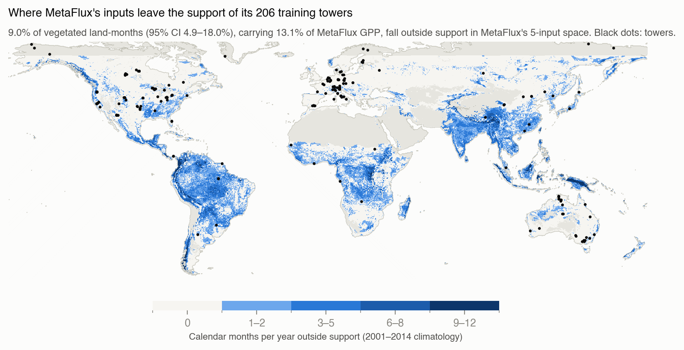
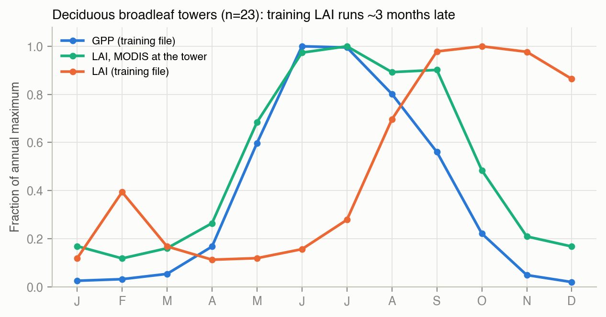

<div align="center">

# Where does MetaFlux extrapolate, and does its uncertainty notice?

**A pre-registered positivity audit of tower-based carbon-flux upscaling**

[](https://github.com/rohanbalixz/flux-upscaling-positivity/actions/workflows/ci.yml)
[](LICENSE)
[](pyproject.toml)
[](docs/PREREGISTRATION.md)

</div>

MetaFlux ([Nathaniel, Liu & Gentine, *Sci. Data* 2023](https://doi.org/10.1038/s41597-023-02349-y)) learns GPP from five inputs at about 200 eddy-covariance towers and applies the learned map to every 0.25° land cell. That step is valid only where two conditions hold:

- **Positivity:** each land cell's inputs resemble inputs some tower has seen.
- **Conditional invariance:** at the same inputs, towers and land share the same GPP response.

This repository measures where the first condition fails, in MetaFlux's own input space. It then tests with tower labels whether failing it matters, asks whether the product's ensemble spread notices, and states how tightly vegetated-land GPP is pinned down once the first condition fails, and under which assumptions.

<p align="center"></p>

## Key findings

**1. About 9% of vegetated land-months fall outside the support of the 206 training towers, carrying about 13% of MetaFlux's GPP.**
- Land-months outside: 9.0% (95% CI 4.9–18.0%). GPP outside: 13.1% (7.0–27.1%).
- Most of the out-of-support GPP is tropical (62% of it): 17.4% of tropical land-months and 20.7% of tropical GPP fall outside. Polar/alpine climates have the largest outside share (31% of land-months) but little GPP.
- Arid (3.1%) and continental (2.2%) climates are well covered.
- In FLUXCOM's richer predictor space, Jung et al. (2020) found the humid tropics well represented.
- These shares depend on the support threshold τ: 0.9–19.5% of land-months across the 99th–90th percentile choices.

**2. 63% of that extrapolation is invisible to a one-variable check.** Every input sits inside the towers' 1st–99th percentile range; only the combination is new. The typical case is a wet (8 mm/d), warm (25 °C), humid, bright and leafy tropical month. Climate-invariant ML (Beucler et al. 2024) matches input distributions one variable at a time; these months suggest checking joint overlap as well.

**3. MetaFlux's ensemble spread does not notice.**
- GPP_std rises with distance to support (Spearman 0.32), but only because GPP does. Controlling for GPP, the correlation is −0.01.
- Relative spread is *lower* outside support (2.3%) than inside (2.8%).
- On held-out towers, a surrogate seed ensemble understates error 8.6× and covers 21% at a nominal 95%.

**4. The product's most extreme values are extrapolations.** Only 67 of 1.9 million cell-months exceed the highest monthly GPP any tower recorded, but 98.5% of them lie outside support, against a 7.7% base rate.

**5. Taking MetaFlux's in-support values as given, towers plus smoothness pin vegetated-land GPP (MetaFlux: 125.8 PgC yr⁻¹) to ±15%.**
- This assumes conditional invariance (A1) and smoothness at the 90th-percentile tower slope. With no smoothness at all, the bound is ±30%.
- Relaxing A1 costs more than dropping smoothness, if the discrepancy shares one sign across land. The systematic site-level discrepancy among towers (1.40 gC m⁻² d⁻¹) widens the bound to ±53%. The pre-registered δ, the in-support cross-validated RMSE, widens it to ±84%, but that δ includes month-level noise, so it is an upper envelope.
- Averaged over towers, the discrepancy is about zero (−0.02), so whether it cancels over land decides how much A1 matters. The data cannot tell.
- See [How tightly the towers pin down GPP](#how-tightly-the-towers-pin-down-gpp).

**6. Ten well-placed towers would bring 39% of the out-of-support GPP back inside support; ten random ones, 8%.** All ten greedy picks are tropical: Borneo, Sumatra, the Congo basin, Indochina and the Amazon.

**7. A data note on the public training files.** In the sample training CSVs, `LAI` and `EVI` run about three months behind the same rows' GPP: 132 of 189 sites are best aligned at +3 months.
- In a surrogate, realigning LAI raises held-out R² from 0.53 to 0.63.
- Whether the production model used these files is unknown. See [`docs/DATA_NOTE_LAI.md`](docs/DATA_NOTE_LAI.md).

## Check the data note in one minute

```bash
python scripts/check_lai_phase.py     # numpy + pandas; reads only the public MetaFlux CSVs
```
```
Pooled within-site correlation of X(t) with GPP(t + k)
k:              -4     -3     -2     -1      0      1      2      3      4
SW_IN_ERA    -0.50  -0.23   0.11   0.42   0.61   0.63   0.48   0.20  -0.14
TA_ERA       -0.23   0.10   0.40   0.60   0.63   0.49   0.22  -0.11  -0.41
LAI           0.61   0.71   0.52   0.18  -0.15  -0.39  -0.52  -0.53  -0.45
EVI           0.60   0.72   0.53   0.17  -0.16  -0.38  -0.49  -0.49  -0.42
```

This check also runs in CI against the live MetaFlux repository.

## Pre-registered predictions and outcomes

Hypotheses, thresholds and falsifiers were fixed in [`docs/PREREGISTRATION.md`](docs/PREREGISTRATION.md) before any outcome was computed.

- **A test guards the file.** It is hash-locked, and [`tests/test_preregistration.py`](tests/test_preregistration.py) fails if it changes.
- **The ordering is self-reported.** The hash was recorded in the same working session as the analysis, not by a third-party registry.
- **Every departure is logged** in [`docs/DEVIATIONS.md`](docs/DEVIATIONS.md).
- **Failed predictions stay in the table.**

| | Prediction | Result (95% interval) | Outcome |
|---|---|---|---|
| P1a | ≥ 10% of vegetated land-months outside support | 9.0% (4.9–18.0%) | not met (narrowly) |
| P1b | Arid > tropical, following Jung et al. 2020 | tropical 17.4% vs arid 3.1%; arid > tropical in 0 of 200 bootstraps | **falsified** |
| P1c | ≥ 25% of outside points inside every marginal range | 63% (46–71%) | met |
| P2 | Held-out RMSE outside / inside ≥ 1.5 (falsifier < 1.1) | 1.18 (0.98–1.38); GBM 1.21 | not met, not falsified (interval spans 1.1) |
| P2b | Site-level partial Spearman (distance, RMSE given GPP) > 0 | 0.09 | met (weak) |
| P3a | Spearman (seed spread, \|error\|) < 0.3 | 0.41 (0.37–0.44) | not met |
| P3b | RMSE / RMS spread > 2, and larger outside support | 8.6 (7.6–9.7); 9.2 inside vs 5.2 outside | first part met, second not |
| P4 | Spearman (GPP_std, distance) < 0.3 (falsifier ≥ 0.5) | 0.32 (0.30–0.35) | not met, not falsified |
| P4b | Same, partial given GPP, < 0.3 | −0.01 (−0.03 to 0.02) | met |
| P4c | Relative spread outside / inside < 1.5 | 0.85 (0.81–0.88) | met |
| P5 | More extrapolation after FLUXNET2015 ends (2015–22 vs 2001–14) | 12.1% vs 11.8% (p = 0.06) | met on paper; negligible |
| H6 | Exploratory: per-site standardisation collapses support | 11.6% outside; held-out RMSE +15% | expectation half wrong |

Every result number in this README is generated in [`results/SUMMARY.md`](results/SUMMARY.md) from the result files; the lag table above is the output of the check script.

## How tightly the towers pin down GPP

Upscaling is a transport problem: $\theta=\sum_i w_i\,\mathbb E[Y\mid X=x_i,S=0]$, with towers as the source $S=1$ and vegetated land-months as the target. It rests on two assumptions:

- **A1 (no $S\to Y$):** towers and land share $\mathbb E[Y\mid X]$.
- **A2:** positivity.

**Inside support.** Under A1 the land-months inside support are point-identified; the bounds below take MetaFlux's values there as given.

**Outside support.** Where A2 fails, the towers identify nothing about those land-months. A selection diagram that treats the inputs as a single node cannot help, though finer structure over the inputs might. An $L$-Lipschitz assumption makes the bound finite, with width growing as $L\,\cdot$ distance to support.

**Which bound is reported.** The sharp version is the McShane–Whitney envelope. The table reports the wider nearest-anchor interval, which is always non-empty ([`docs/THEORY.md`](docs/THEORY.md)).

| Assumption | median tower slope $L_{50}$ | 90th-percentile slope $L_{90}$ | no smoothness |
|---|---|---|---|
| A1 exact | 123–135 PgC yr⁻¹ (±4.9%), *inconsistent with the tower anchors* | 113–152 (±15%) | 109–184 (±30%) |
| A1 ± δ, δ = systematic site-level discrepancy (1.40) | ±44% | ±53% | ±65% |
| A1 ± δ, δ = in-support CV RMSE (2.64; pre-registered upper envelope) | ±75% | ±84% | ±94% |

- **$L_{50}$ is inconsistent with the anchors:** at the median slope, the anchors cannot be interpolated by any $L$-Lipschitz function near 88% of out-of-support points; at $L_{90}$, near 5%. The anchors are noisy site-month means, so noise contributes to this.
- **Breakdown value:** a ±10% bound needs $L \le L^* = 5.2$, which is 2.2× the median slope.
- **What the δ rows assume:** every land-month is shifted by δ in the same direction, the worst case. The in-support error splits into a systematic site-level part (1.40) and month-to-month scatter (2.32); across towers the systematic part averages to −0.02.
- **Evidence against exact A1 among the towers:** 31% of near-identical input pairs at different sites differ by more than 2 gC m⁻² d⁻¹.

## Figures

| | |
|:---:|:---:|
|  |  |
| Extrapolation by climate, and how much a one-variable check misses | Ensemble spread against distance to support |
|  |  |
| Bound on vegetated-land GPP against the smoothness constant | Where ten new towers help most |
|  |  |
| LAI phase in the sample training files | No drift out of support after the tower record ends |

## Approach

| Component | Choice |
|---|---|
| Source | 15,948 tower site-months, using the exact `xcolumns` of the MetaFlux notebooks |
| Target | Every vegetated 0.25° cell × month, built from ERA5 (WeatherBench2 / ARCO-ERA5) and full-resolution MODIS MOD15A2H LAI, mirroring the paper's upscaling inputs. Validated against the training inputs at tower cells (r = 0.73–0.99). |
| Support | Pooled z-scores (paper Eq. 2). A cell-month is outside if it is farther from every tower month than τ, the 95th percentile of each tower's distance to towers more than 55 km away. 200-replicate site bootstrap; τ, metric and representation varied in robustness checks; a domain classifier gives AUC 0.91. |
| Labels | A surrogate of MetaFlux's MLP (2 × 350, 5 seeds) plus gradient boosting, under spatially blocked 10-fold CV with whole 55 km site clusters held out |
| Product | The MetaFlux v3.1 monthly GPP and GPP_std, with a 5° block bootstrap |

Details are in [`docs/METHODS.md`](docs/METHODS.md); theory is in [`docs/THEORY.md`](docs/THEORY.md).

## Repository layout

```
├── src/flux_positivity/     # the package: grid, physics, Köppen, support, bounds, data builders
│   └── config.py            # every analysis parameter, keyed to the pre-registration
├── pipeline/                # numbered steps 00–11 (make all)
├── scripts/check_lai_phase.py
├── tests/                   # unit tests, including a guard on the pre-registration hash
├── results/                 # JSON/CSV outputs, SUMMARY.md, run_info.json
├── figures/
└── docs/                    # PREREGISTRATION, DEVIATIONS, METHODS, THEORY, DATA_NOTE_LAI, ROADMAP, REPRODUCE
```

## Reproduce

```bash
python -m pip install -e ".[inputs,dev]"
make test        # seconds
make check-lai   # ~1 minute
make all         # ~35 minutes, public data only, no credentials
```

See [`docs/REPRODUCE.md`](docs/REPRODUCE.md) for step timings, data licences and the determinism notes.

## Limitations

- **Support is a threshold.** "Outside support" means farther than τ from every tower month; the share outside ranges from 0.9% to 19.5% as τ moves from the 99th to the 90th percentile.
- **Monthly vectors only.** MetaFlux's LSTM members see 30-step sequences, so monthly-vector support is a lower bound on extrapolation.
- **A surrogate, not the production model.** MetaFlux's trained weights are not public; the surrogate tests the input space and the sites.
- **Different reanalysis versions.** Tower inputs are FLUXNET2015's ERA-Interim-based columns, while gridded inputs are ERA5; the size of the mismatch is quantified.
- **Bounds outside support only.** Inside support the bounds take MetaFlux's values as given, without propagating their estimation error.

Next steps, including the same positivity question for DifferLand's 2081–2099 space-for-time projection, are in [`docs/ROADMAP.md`](docs/ROADMAP.md).

## Related work

- Jung et al. 2020, *Biogeosciences* 17:1343 (FLUXCOM extrapolation index and severity index).
- Meyer & Pebesma 2021, *Methods Ecol. Evol.* (area of applicability).
- Pallandt et al. 2022, *Biogeosciences* (pan-Arctic network design).
- Fries et al. 2026, arXiv 2605.19812 (FLUXtrapolation benchmark).
- Rozanov et al. 2026, KDD (CarbonBench).
- Beucler et al. 2024, *Sci. Adv.* (climate-invariant ML).
- Jalaldoust, Bellot & Bareinboim 2024, NeurIPS (partial transportability).
- Pearl & Bareinboim 2011, 2014 (transportability).

## Citation

If you use this work, please cite MetaFlux and this repository ([`CITATION.cff`](CITATION.cff)):

```bibtex
@software{bali_flux_positivity_2026,
  author  = {Bali, Rohan},
  title   = {Where does MetaFlux extrapolate, and does its uncertainty notice?
             A pre-registered positivity audit of tower-based carbon-flux upscaling},
  year    = {2026},
  version = {1.0.0},
  url     = {https://github.com/rohanbalixz/flux-upscaling-positivity}
}
```

## Acknowledgements

This work builds entirely on openly released data and code:

- MetaFlux (J. Nathaniel, J. Liu, P. Gentine), its training files and product;
- FLUXNET2015 and its site teams;
- ERA5 via WeatherBench2 and ARCO-ERA5 (Google Research);
- MODIS LAI via Microsoft Planetary Computer.

Any errors are mine.
