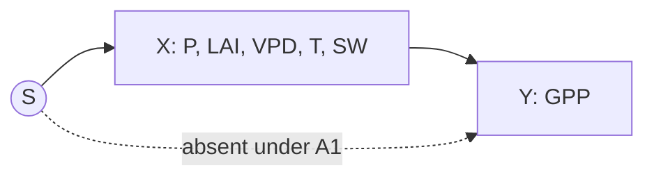

# Theory: transport, positivity and partial identification

This note states what the tower data identify about upscaled GPP, what they only bound, and which assumption does the work. Numbers refer to [`results/SUMMARY.md`](../results/SUMMARY.md).

## Setting

| Symbol | Meaning |
|---|---|
| $S=1$ | source population: tower site-months (206 FLUXNET2015 sites) |
| $S=0$ | target population: vegetated land cell-months |
| $X \in \mathbb{R}^5$ | MetaFlux inputs: precipitation, LAI, VPD, air temperature, incoming shortwave |
| $Y$ | GPP |
| $\mu(x) = \mathbb{E}[Y \mid X=x, S=1]$ | the mapping the towers can teach |
| $\mu^*(x) = \mathbb{E}[Y \mid X=x, S=0]$ | the mapping the upscaled product needs |

The target inputs $x_1,\dots,x_N$ are observed, from ERA5 and MODIS. Each $x_i$ gets a weight $w_i$ equal to days × cell area. The estimand is total GPP:

$$\theta = \sum_{i=1}^{N} w_i\, \mu^*(x_i).$$

## Selection diagram

- **The arrow $S \to X$** says towers sit in particular climates and ecosystems. This is covariate shift, and it is measured directly.
- **An arrow $S \to Y$** would mean towers differ from the surrounding land *at the same inputs*. Possible causes are siting on homogeneous, well-managed patches, footprint versus pixel mismatch, and ecosystem properties not captured by the five inputs.

## Assumptions

- **A1, conditional invariance (no $S \to Y$):** $\mu^*(x) = \mu(x)$ for all $x$.
- **A2, positivity:** every $x_i \in \operatorname{supp} P(X \mid S=1)$.

**Proposition 1 (transport formula; Pearl & Bareinboim 2011).** Under A1 and A2, $\theta = \sum_i w_i\, \mu(x_i)$, which is identified from tower data.

Upscaling products implicitly assume both A1 and A2. They are logically independent, and only A2 can be checked from inputs alone.

## When positivity fails

Let $O = \{i : x_i \notin \operatorname{supp} P(X \mid S=1)\}$, the out-of-support cell-months.

For $i \in O$, the tower data place no restriction on $\mu(x_i)$ beyond the outcome range, *even if A1 holds*. Hence (Manski 1990):

$$\theta \in \Big[\sum_{i \notin O} w_i \mu(x_i) + y_{\min}\!\sum_{i\in O} w_i,\;\; \sum_{i \notin O} w_i \mu(x_i) + y_{\max}\!\sum_{i\in O} w_i\Big].$$

This kind of non-identifiability is different from the one studied in partial transportability (Jalaldoust, Bellot & Bareinboim, NeurIPS 2024). There, positivity is assumed, so the domains share support and every unidentified quantity traces back to mechanisms that may differ between domains (the discrepancy set). Here the mechanism can be shared and the target is still unidentified, because the source never visits the region where part of the target lives.

**Consequence.** Off the support, a selection diagram cannot substitute for a functional-form or smoothness restriction. Any $\mu^*$ that agrees with $\mu$ on the support is compatible with both the diagram and the data.

## Adding smoothness

Let $\mathcal F_L = \{f : |f(x)-f(x')| \le L\,\lVert x-x'\rVert\}$, with distances in the pooled z-scored input space. The anchors $(a_k, y_k)$ are tower site × calendar-month means.

**Proposition 2 (McShane 1934; Whitney 1934).** Suppose the anchors are $L$-consistent, meaning $|y_j - y_k| \le L\lVert a_j - a_k\rVert$ for all $j, k$. Then for every $x$,

$$\sup_{f\in\mathcal F_L,\, f(a_k)=y_k} f(x) = U(x) := \min_k \{y_k + L\lVert x-a_k\rVert\},\qquad \inf = \Lambda(x) := \max_k \{y_k - L\lVert x-a_k\rVert\}.$$

*Proof.*
- **Validity.** Every admissible $f$ satisfies $f(x) \le f(a_k) + L\lVert x-a_k\rVert$ for each $k$, so $f \le U$. By the same argument, $f \ge \Lambda$.
- **Attainment.** $U$ is a minimum of $L$-Lipschitz functions, so $U \in \mathcal F_L$. $L$-consistency gives $U(a_k) = y_k$. So $U$ is itself admissible and attains the supremum, and the same holds for $\Lambda$. ∎

**Corollary (sharp bounds on θ).** $\theta$ is a positive linear functional of $f$. Its supremum over the class is therefore attained by the single function $U$:

$$\theta \in \Big[\sum_{i\notin O} w_i\mu(x_i) + \sum_{i\in O} w_i \Lambda(x_i),\; \sum_{i\notin O} w_i\mu(x_i) + \sum_{i\in O} w_i U(x_i)\Big],$$

and no narrower interval is valid for $\mathcal F_L$.

**Nearest-anchor interval (what the pipeline reports).** Let $k^*$ be the anchor nearest $x$ and $d^* = \lVert x - a_{k^*}\rVert$. Then

$$f(x) \in [y_{k^*} - L d^*,\; y_{k^*} + L d^*] \supseteq [\Lambda(x), U(x)].$$

This interval is sharp given anchor $k^*$ alone and is never empty. Before clipping to $[0, y_{\max}]$, the half-width it contributes to $\theta$ is

$$L \cdot \sum_{i \in O} w_i\, d^*(x_i):$$

linear in $L$, with slope equal to the weighted distance of the out-of-support mass to the support.

## What the data say about L

$L$ is not identified. The towers constrain it from one side only: an $L$ is rejected if nearby anchors cannot be interpolated by any $L$-Lipschitz function. In that case $\Lambda(x) > U(x)$, which the pipeline reports as the *infeasible share*. The pipeline reports four quantities:

- $L_{50}$ and $L_{90}$: quantiles of the slopes $|y_j - y_k| / \lVert a_j - a_k\rVert$ between anchors from different sites (more than 55 km apart) at distances in $[\tau/2, 2\tau]$;
- the McShane–Whitney infeasible share at each of those values: the data reject $L_{50}$ (88% infeasible) but not $L_{90}$ (5%);
- the **breakdown value** $L^* = \sup\{L : \text{half-width}(\theta) \le 10\%\}$, here $2.2\times L_{50}$.

Reporting breakdown values rather than a single $L$ follows sensitivity analysis in the Rosenbaum and Manski tradition. A reader who believes a particular $L$ can read off the bound it implies.

## Relaxing A1

Suppose $|\mu^*(x) - \mu(x)| \le \delta$ for all $x$. Then every term of $\theta$, inside the support included, widens by $\pm\delta$.

The pipeline calibrates $\delta$ by the in-support, spatially blocked cross-validated RMSE of a surrogate model. That is the empirical scale of how much towers with the same inputs differ.

## What each assumption buys (MetaFlux)

| Assumption on $\mu^*$ | In support (87% of GPP mass) | Off support (13%) | Bound on global GPP |
|---|---|---|---|
| A1 + $\mathcal F_{L_{90}}$ | identified | $\pm L d^*$ | ±15% |
| A1, no smoothness | identified | $[0, y_{\max}]$ | ±30% |
| A1 relaxed by δ + $\mathcal F_{L_{90}}$ | $\pm\delta$ | $\pm(L d^* + \delta)$ | ±84% |

**Reading the table.**

- The causal assumption A1 does most of the work, because it makes the in-support mass point-identified.
- Smoothness governs only the off-support remainder.
- The towers themselves strain A1. Among pairs of anchors from different sites whose inputs are nearly identical ($< \tau/2$ apart), 31% differ by more than 2 gC m⁻² d⁻¹ in GPP. This points to variables outside the five inputs, such as vegetation type, management or footprint.

## Strict versus practical positivity

Strict support fails for 9% of land-months. However, a classifier separates towers from land with AUC 0.91, so the density ratio $p^*(x)/p(x)$ is extreme even inside the support.

- **For estimation**, practical overlap is the binding constraint: importance-weighted transport estimators would have very large variance.
- **In theory terms**, this is the regime studied in covariate-shift theory through transfer exponents (Kpotufe & Martinet 2021, *Ann. Statist.*), where the target puts mass in regions of low source density.

## References

- Jalaldoust, K., Bellot, A. & Bareinboim, E. (2024). Partial transportability for domain generalization. *NeurIPS*.
- Kpotufe, S. & Martinet, G. (2021). Marginal singularity and the benefits of labels in covariate-shift. *Ann. Statist.* 49(6).
- Manski, C. F. (1990). Nonparametric bounds on treatment effects. *Am. Econ. Rev.* 80(2), 319–323.
- McShane, E. J. (1934). Extension of range of functions. *Bull. AMS* 40, 837–842.
- Pearl, J. & Bareinboim, E. (2011). Transportability of causal and statistical relations: a formal approach. *AAAI*.
- Pearl, J. & Bareinboim, E. (2014). External validity: from do-calculus to transportability across populations. *Stat. Sci.* 29(4).
- Whitney, H. (1934). Analytic extensions of differentiable functions defined in closed sets. *Trans. AMS* 36, 63–89.
